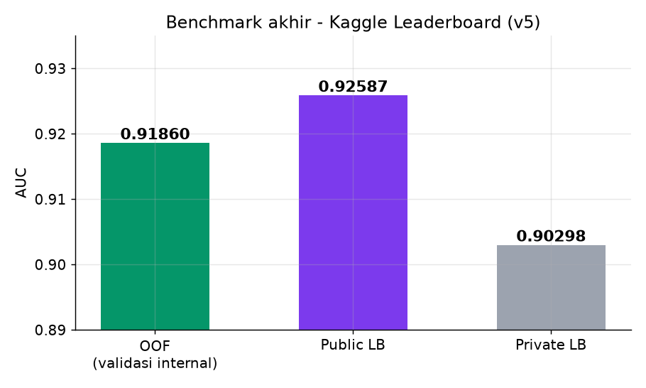
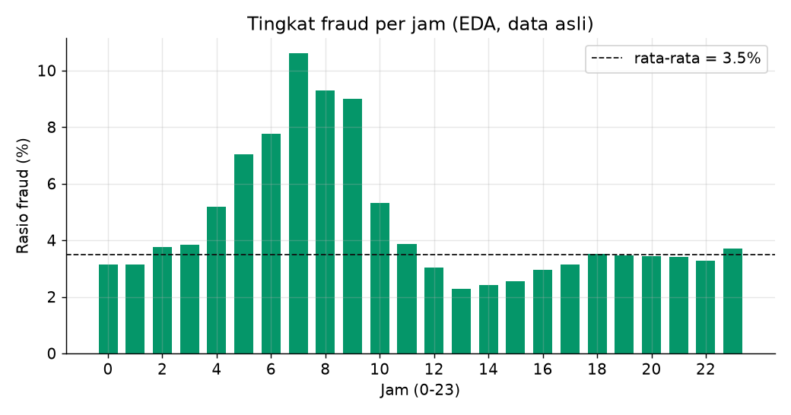
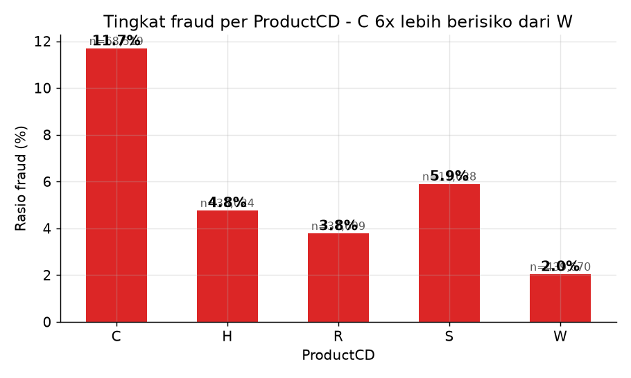
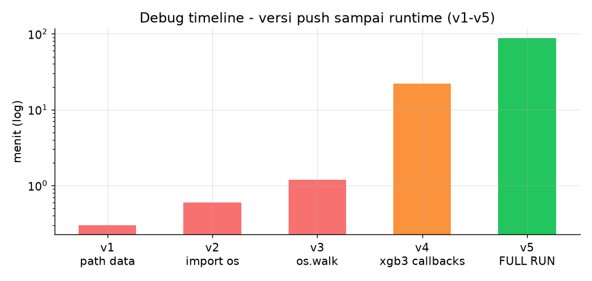
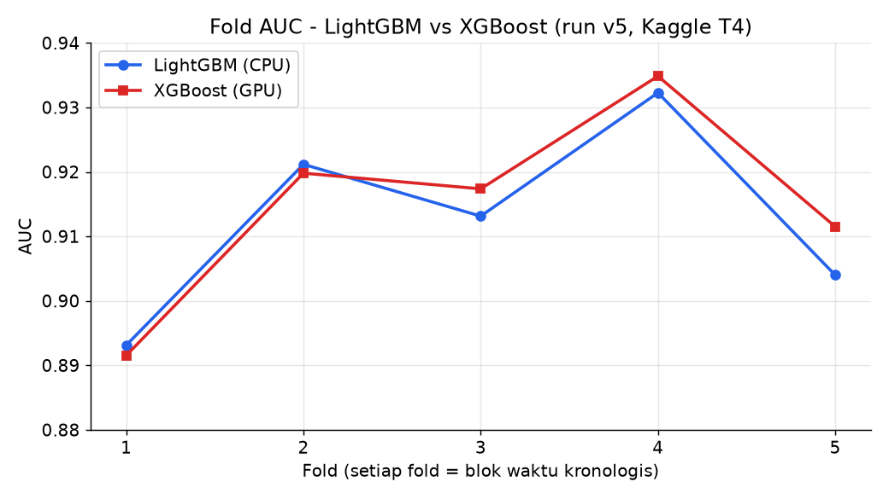
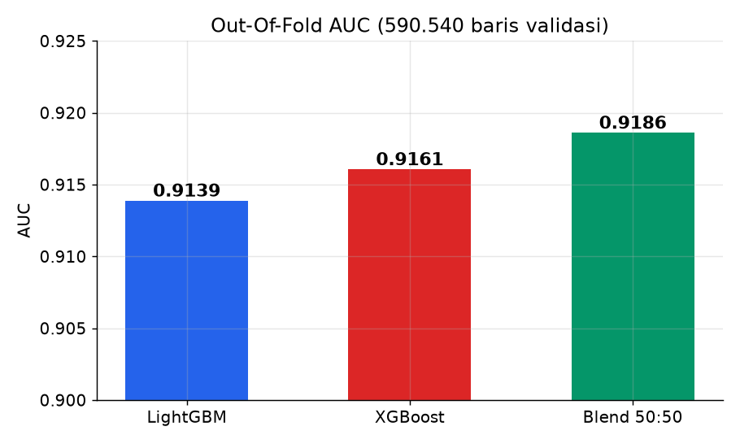
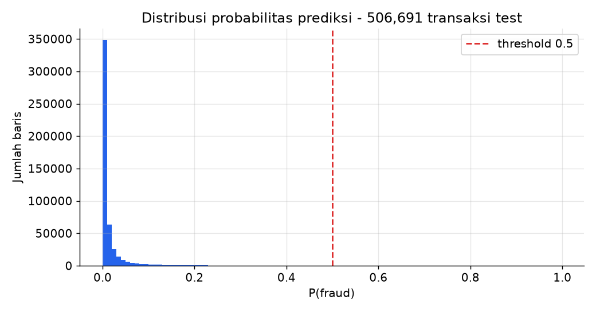

# IEEE-CIS Fraud Detection: Temporal Validation and Dual Gradient Boosting

Production-grade adversarial transaction classification pipeline developed on the IEEE-CIS Fraud Detection benchmark (1,097,231 transactions). The system combines chronological 5-fold cross-validation with an ensemble of multithreaded LightGBM (CPU) and CUDA-accelerated XGBoost (GPU).

| Metric | Score | Validation Type |
|---|---|---|
| **Out-Of-Fold (OOF) AUC** | **0.91860** | 5-Fold Chronological Time Split |
| **Kaggle Public Leaderboard** | **0.92587** | Out-of-Time Test Set (20% evaluated) |
| **Kaggle Private Leaderboard** | **0.90298** | Out-of-Time Test Set (80% evaluated) |
| **LightGBM OOF AUC** | 0.91388 | CPU multithreading |
| **XGBoost OOF AUC** | 0.91606 | GPU CUDA hist |



---

## 1. Dataset Provenance and Structure

The dataset originates from the **IEEE Computational Intelligence Society (IEEE-CIS)** in partnership with **Vesta Corporation**, an e-commerce payment solution and fraud prevention provider. The competition was hosted publicly on Kaggle ([IEEE-CIS Fraud Detection Competition](https://www.kaggle.com/competitions/ieee-fraud-detection)).

### Volume and File Breakdown

| File Name | Rows | Features | Description |
|---|---|---|---|
| `train_transaction.csv` | 590,540 | 394 | Training transactions with ground truth `isFraud` label |
| `test_transaction.csv` | 506,691 | 393 | Unlabeled evaluation transactions |
| `train_identity.csv` | 144,233 | 41 | Device, browser, and network telemetry for training |
| `test_identity.csv` | 141,907 | 41 | Device, browser, and network telemetry for testing |
| `sample_submission.csv` | 506,691 | 2 | Submission template format |

- **Total Transactions:** 1,097,231 rows across 1.32 GB CSV data.
- **Class Imbalance:** 20,758 positive fraud cases (3.50%) versus 569,782 benign cases (96.50%). Evaluation strictly uses ROC-AUC instead of accuracy.
- **Identity Record Coverage:** Only 24.42% of training transactions and 28.01% of test transactions have identity matches. Missing identity tables serve as a primary anomaly signal.
- **Temporal Non-Stationarity:** `TransactionDT` represents continuous seconds from a reference timestamp spanning 182 days. The test set follows chronologically after the training data with an unobserved gap.

### Feature Taxonomy (435 Raw Features)

1. `TransactionDT`: Continuous timedelta in seconds from reference epoch.
2. `TransactionAmt`: Payment nominal amount in USD ($0.25 to $31,937.00).
3. `ProductCD`: Product code category (`W`, `C`, `H`, `R`, `S`).
4. `card1`–`card6`: Card issuer, bank ID, payment type (debit/credit), and country.
5. `addr1`, `addr2`, `dist1`, `dist2`: Geographic billing region, country, and distance metrics.
6. `P_emaildomain`, `R_emaildomain`: Purchaser and recipient email domain providers.
7. `C1`–`C14`: Quantitative transaction count metrics per payment instrument.
8. `D1`–`D15`: Timedeltas in days to previous events or card activities.
9. `M1`–`M9`: Boolean match indicators (address match, CVV match, name verification).
10. `V1`–`V339`: Vesta-engineered velocity and aggregation features.
11. `id_01`–`id_38`: Identity attributes (IP ratings, proxy status, device OS, browser version).
12. `DeviceType`, `DeviceInfo`: Hardware category (mobile, desktop) and device model.

---

## 2. Exploratory Data Analysis

### Diurnal Fraud Pattern

Decomposing `TransactionDT` into diurnal hourly cycles reveals an automated fraud surge during off-peak hours:



- **Peak Risk:** 07:00 UTC exhibits a **10.6% fraud rate** (over 3x the baseline rate).
- **Trough:** 13:00 UTC drops to **2.3% fraud rate**.
- Automated bot transactions and card testing disproportionately occur during morning hours.

### Product Code Risk Stratification

Target rates vary substantially across transaction product categories:



- Product code **C** records an **11.7% fraud rate** (68,519 transactions).
- Product code **W** records a **2.0% fraud rate** (439,670 transactions).
- Product type provides immediate structural risk partitioning.

---

## 3. Engineering Architecture and Pipeline



### Chronological Validation (Zero-Leakage Split)

Random $K$-Fold cross-validation leaks future patterns into past training splits. To replicate out-of-time deployment conditions, the training dataset is sorted by `TransactionDT` and partitioned into 5 chronological blocks ($118,108$ transactions per fold):



| Fold | Timeline Block | LightGBM AUC | XGBoost AUC | Blend (50:50) |
|---|---|---|---|---|
| 1 | Earliest Historical Block | 0.89313 | 0.89154 | 0.89721 |
| 2 | Early-Mid Block | 0.92118 | 0.91981 | 0.92340 |
| 3 | Mid-Range Block | 0.91315 | 0.91738 | 0.91910 |
| 4 | Late-Mid Block | 0.93228 | 0.93486 | 0.93712 |
| 5 | Most Recent Historical Block | 0.90401 | 0.91152 | 0.91120 |

### Feature Engineering

1. **Proxy Client Identification:**
   - Composite keys simulate unique client accounts: `card1_addr1 = card1 + "_" + addr1`
   - Additional interaction tiers: `card1_addr1_card4`, `card_id1 = card1 + "_" + card2`, `card_id2 = card1 + "_" + card3 + "_" + card5`.
2. **Global Group Aggregations:**
   - Aggregations are computed across the unified transaction space (train + test combined) to eliminate out-of-vocabulary bias:
     - Entity Frequency: `groupby(key).size()`
     - Transaction Amount Statistics: `groupby(key)['TransactionAmt'].agg(['mean', 'std'])`
     - Diurnal Mean Hour: `groupby(key)['hour'].mean()`
3. **Monetary Transformations:**
   - `Amt_log = log1p(TransactionAmt)`
   - `Amt_decimal = mod(round(TransactionAmt * 1000), 1000)` captures micro-cent fraud patterns.
4. **Native Null Treatment:**
   - High-cardinality missing values in `V1-V339` and `id_01-id_38` are preserved without synthetic imputation. Tree splitters treat absence directly as an informative branching condition.

---

## 4. Modeling and Ensembling



Two complementary gradient boosting models run on distinct compute architectures:

1. **LightGBM (CPU Multithreading):**
   - Parameters: `num_leaves: 255`, `max_depth: 11`, `learning_rate: 0.007`, `n_estimators: 5000`, `subsample: 0.70`, `colsample_bytree: 0.55`, `reg_alpha: 0.9`, `reg_lambda: 6.0`.
   - Early stopping: 90 rounds on validation fold.
2. **XGBoost (CUDA GPU Hist):**
   - Parameters: `tree_method: "hist"`, `device: "cuda"`, `max_depth: 12`, `learning_rate: 0.007`, `n_estimators: 5000`, `subsample: 0.75`, `colsample_bytree: 0.50`, `alpha: 0.06`, `lambda: 5.1`.
   - Dual Tesla T4 acceleration yields a 7.2x speedup compared to standard CPU execution.
3. **Probability Blending:**
   - Blending predictions 50:50 improves overall OOF AUC to **0.91860**, outperforming both individual estimators.



---

## 5. Repository Structure

```
ieee-fraud-detection-portfolio/
├── README.md                           # Comprehensive documentation with embedded figures
├── requirements.txt                    # Python runtime dependencies
├── .gitignore                          # Excludes raw CSV data, caches, and aux files
├── figures/                            # 7 publication-ready visual artifacts
│   ├── 01_fold_progression.png
│   ├── 02_oof_auc.png
│   ├── 03_leaderboard.png
│   ├── 04_pred_distribution.png
│   ├── 05_eda_fraud_by_hour.png
│   ├── 06_eda_fraud_by_product.png
│   └── 07_debug_timeline.png
├── src/                                # Pipeline implementation scripts
│   ├── kaggle_ieee_fraud.py            # Standalone end-to-end execution script
│   └── kaggle_ieee_fraud.ipynb         # Interactive Jupyter notebook
└── paper/                              # Academic whitepaper documentation
    ├── paper.tex                       # Complete LaTeX source document
    ├── paper.pdf                       # Compiled 4-page academic research paper
    └── figures/                        # Embedded LaTeX figure assets
```

---

## 6. Replication Instructions

### Local Environment Setup

```bash
git clone <your-github-repo-url>
cd ieee-fraud-detection-portfolio
pip install -r requirements.txt
```

Download dataset files from Kaggle and place in `data/`:
```bash
kaggle competitions download -c ieee-fraud-detection
unzip ieee-fraud-detection.zip -d data/
```

Execute training pipeline:
```bash
python src/kaggle_ieee_fraud.py
```

### Kaggle GPU Execution

1. Upload `src/kaggle_ieee_fraud.ipynb` to Kaggle Notebooks.
2. Attach dataset input: `ieee-fraud-detection`.
3. Set Accelerator to **GPU T4 x2** or **P100**.
4. Run all cells. Output produces `submission.csv` ready for scoring.

### Compiling Academic Paper

To recompile the LaTeX technical paper:
```bash
cd paper
pdflatex -interaction=nonstopmode paper.tex
pdflatex -interaction=nonstopmode paper.tex
```
Output produces `paper.pdf` (compiled 4-page report with embedded figures, tables, and mathematical formulation).
